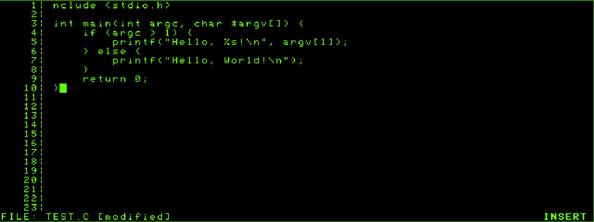
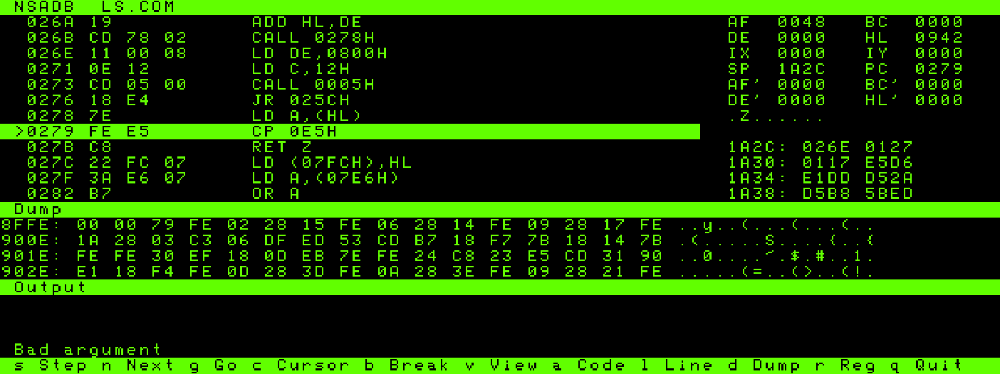

# Z80 programs for CP/M

This repository contains some Z80 programs for the CP/M operating system, that I use on my NorthStar Advantage, also a disk image called TOOLS.NSI with the tools included.
The time goes on, and after many years using linux, I still enjoy tinkering with my NorthStar Advantage, but DIR nowadays is not something that comes from my fingers as naturally as it once did, so I wrote some tools to make my life easier when I play with it.

## Contents

- [VI](#vi) - a mini vi text editor for CP/M 2.2 (there ius also a VT100 version)
- [URUN](#urun-a-program-from-another-user-area) - run a program from another user area
- [NSADB](#nsadb-a-debugger) - a full-screen source-level debugger for the NorthStar Advantage
- [MKDBG](#mkdbg-the-debug-file-made-on-the-machine) - create a debug file from the Microsoft M80 listing on the machine
- [LS](#ls-a-directory-listing-tool) - a simple directory listing tool for CP/M 2.2
- [LESS](#less-a-pager-for-text-files) - a pager for text files on CP/M 2.2
- [COPY](#copy) - copy files between user areas on CP/M 2.2
- [TOOLS](#tools) - miscellaneous tools for CP/M 2.2 (CAT, MV, RM etc..)

NOTE: nsadb requires CP/M 2.2 rev 1.2.0 (NSD_BASE 8800h)

## VI



A small modal text editor for CP/M 2.2, written in Z80 assembly. It expects an
80×24 ANSI/VT100-compatible console. The document view has a five-column line
number gutter and displays up to 73 text columns per line. 

## URUN: a program from another user area

CP/M 2.2 only finds a `.COM` file in the user area that is active, so in
`J:` user 5 you cannot type `A:VI` if `VI.COM` is in user 0 of `A:`. `URUN`
loads the program from the other user area and runs it in the current one, so
the program works on the files of the current area.

```text
URUN [/Un] [d:]program [arguments]
```

- `URUN A:VI NOTES.TXT` loads `A:VI.COM` from user 0 and runs it in the user
  area where you are, so it opens `NOTES.TXT` there. Without an extension
  `.COM` is assumed, and without a drive the current drive is used.
- `URUN /3 C:VEDIT NOTES.TXT` (or `/U3`) loads the program from user 3.
- The program gets the same command tail and FCBs as from the CCP, and when it
  ends the user area is the one you were in.
- `URUN.COM` has to be in the user area where you type it: copy it once to each
  area you use (it is under 1 KB). `make disk` makes a floppy image `TOOLS.NSI` with all the programs (in the `disk_images` folder of the emulator; set `TOOLS_DISK` for another place). `make copy` puts it in the user areas of
  `DATA.NSI` listed in `URUN_USERS` (default `0`; for example
  `make copy URUN_USERS="0 5"`). For another image use
  `nsdisk -p -u 5 IMAGE build/stage/URUN.COM`, with `-d J` for a drive of a hard
  disk image.
- Limits: the program has to fit below the CCP (about 54 KB on the Advantage),
  it runs in the current user area and not in its own (a program that looks for
  its own files next to the `.COM` will not find them), and `URUN` does not stay
  in memory. The loader assumes a 2 KB CCP just below the BDOS.

## NSADB: a debugger



`NSADB` is a full-screen, source-level debugger for the NorthStar Advantage, like Turbo
Debugger. It is a CP/M program and it runs on the real machine and in the `emu_na` emulator.

```text
NSADB [d:]program [arguments]
```

- `program.COM` is loaded at `0100h` with the command tail and FCBs as the CCP gives them.
- If `PROGRAM.DBG` is on the same drive and user area, NSADB shows the source. Make the
  file with `python3 tools/mkdbg.py -I src/common -o build/prog.dbg src/prog/prog.asm`
  and put it on the disk next to the `.COM`. Without it, NSADB shows the disassembly.
- The screen has the code or source, the registers (with the shadow set), the flags, the
  stack, a memory dump and an Output window for what the program prints through the BDOS.
- Main keys: `s` step, `n` step over calls, `g` go, `c` run to the cursor, `b` set or clear
  a breakpoint (up to 16), `v` source or code, `a` `l` `d` go to an address, a line or a dump
  address, `r` set a register, `m` write bytes, `q` quit. Numbers are hexadecimal.
- Limits: the program has the memory below `8800h` (VI does not fit); there are no watches
  and no conditional breakpoints; a program that runs without a breakpoint cannot be stopped.

See [docs/nsadb.md](docs/nsadb.md) for the keys, the debug file and how it works.

## MKDBG: the debug file, made on the machine

`tools/mkdbg.py` makes `PROG.DBG` (the file that NSADB reads for the source) on the host. `MKDBG`
makes the same file on the Advantage, from the listing of Microsoft M80, so a program that is
assembled with M80 and linked with L80 on the machine can be debugged with its source.

```text
MKDBG [-b ADDR] [-d ADDR] [d:]PROG
```

`PROG.PRN` (the listing) and `PROG.COM` have to be on the drive of the name (the current one if
it has none). `PROG.DBG` goes to the same drive, and an old one is replaced. The last message
shows the records of the file, and the lines, files and labels.

```text
M80 PROG,PROG=PROG        assemble: PROG.REL and the listing PROG.PRN
L80 PROG,PROG/N/E         link: PROG.COM
MKDBG PROG                PROG.DBG
NSADB PROG                debug with the source
```

- A program with `ASEG` and `ORG` has final addresses in the listing and needs no option.
- A program with `CSEG` has relative addresses. L80 (`/N`) makes a COM file that begins with
  `JP start`, then the data segment (from 0103h), then the code, so MKDBG takes the address of the
  code from the target of that jump minus the place of the label that `END` names (`END START`).
  Without that jump or label the code is at 0100h.
- `-b ADDR` gives the address of the code and `-d ADDR` the one of the data segment (0103h if
  not given), both in hexadecimal, for a program that was linked in another way (`/P:`, `/D:`).
- The lines of an included file (`INCLUDE`, `MACLIB`) get their own file in NSADB; the code of a
  macro expansion goes to the line of the call; the bytes of data (`DB`, `DW`, `DS` ...) are not
  lines. Labels are the names with a colon in the source (M80 keeps only six characters of a
  name; MKDBG takes the whole name, up to 29 characters), not constants (`EQU`, `DEFL`, `SET`,
  `=`) or macros.

Limits (each stops with a message): 3,000 addresses and 3,000 lines with code, 300 labels, 15
included files, 60,000 lines of source, and an index of 16 records (the size NSADB reads). A
program with code in both `ASEG` and `CSEG`, a listing without the page of symbols (M80 stopped),
a name with `*` or `?`, and a code segment that would pass FFFFh are refused. The program needs
44 KB (it ends at `ADF9h`) and is limited by the disk: about 45 seconds for 300 lines of source
on the floppy image of the emulator.

Make the listing every time you assemble: CP/M 2.2 has no file dates, so MKDBG cannot tell an
old `PROG.PRN` from a new one. Do not use `/X`, `.XLIST` or other controls that leave lines out of
the listing: the line numbers of NSADB would be wrong. `tools/mkdbg.py --prn PROG.PRN --com
PROG.COM` makes the same file on the host (it is the reference of the program, and
`tests/emu/mkdbg_m80.py` compares the two byte for byte). See [docs/mkdbg.md](docs/mkdbg.md) for
the format of the listing and the tests.

## TERM: a serial terminal

`TINFO [-t]` shows the system and the boards (the six slot ids, the serial board and its status) and
tests the serial line, for when `TERM` or `XMODEM` do not work on the machine. `TERM [-b rate] [-d bits] [-p N|E|O] [-s stops] [-x] [-e] [-h]` connects the Advantage to another computer through the serial board
(a Raspberry Pi that runs `getty` on a USB-to-RS232 cable, for example): the keys go to the line and what
comes from the line is shown on the screen, 23 rows of 80 columns and a status line, with the part of
the VT100/ANSI escape sequences that a shell needs (cursor moves, erase, inverse). The rate is 9600 baud
8N1 unless `-b` says 1200, 2400, 4800 or 19200 and `-d`, `-p` and `-s` say the data bits, parity and stop bits; `-x` uses XON/XOFF, `-e` shows what is typed. The function
keys do local commands (F1 rate, F2 send ESC, F3 send Ctrl-C, F4 clear, F5 echo, F6 flow, F10 quit; the
table is at the top of the source and can be changed); Ctrl-[ sends ESC. It was tested with the emulator
only (a script plays the Pi), so the cable and the speed of the real machine are not checked. See
[docs/term.md](docs/term.md) for the keys, the setup of the Pi and the cable.

## LS and LESS

`LS` lists a disk with the names sorted. It runs on any CP/M 2.2 system.

```text
LS [-l] [-a] [-1] [-s] [d:][pattern]
```

- No option: names in columns. `-l` one file a line with the size in K and the `R`/`S`
  attributes, `-1` one name a line, `-a` all the user areas (`u:NAME.EXT`), `-s` the largest first.
- The pattern has `*` and `?`; `LS B:` lists drive B. The last line shows the number of
  files and the free space, as `STAT` does. The table holds 255 files.

`LESS` pages through a text file on the Advantage, in both directions, with search. The
file is read from the disk by record, so it can be larger than the memory (up to 12,288 lines).

```text
LESS [-x] [-n] [d:]file
```

- Keys: space/`f` and `b` a page forward and back, Enter/`j` and `k` a line, `d`/`u` half
  a page, `g` and `G` the start and the end, `/text` and `?text` search (the case is
  ignored), `n` and `N` the next match, Left/Right sideways, `h` help, `q` quit.
- `-x` shows the file in hexadecimal: offset, 16 bytes and characters. `-n` numbers the lines.

See [docs/ls_less.md](docs/ls_less.md).

## Small tools unix lookalikes

Console tools for any CP/M 2.2 system, in `src/tools/`. CP/M makes the command line capital
letters, so options have no case, the text of `GREP` is searched without regard to case, and
a text with blanks goes between quotes. File names may have `*`, `?` and a drive.

| Tool | Use |
| --- | --- |
| `CAT [-n] files` | show files; `-n` numbers the lines |
| `WC [-l] [-w] [-c] files` | lines, words and bytes |
| `HEAD [-n N] files` | the first N lines (10) |
| `TAIL [-n N] files` | the last N lines (10) |
| `GREP [-n] [-c] [-l] [-v] [-r] text files` | the lines with the text; `^` and `$` anchor it to the line ends; `-r` looks in all the user areas |
| `CRLF [-u] [-f] [-t N] in out` | change line ends (to CR LF, or to LF with `-u`) and expand tabs |
| `CMP [-l] [-t] file1 file2` | the first difference of two files (`-l` lists 20) |
| `DIFF file1 file2` | the lines that two text files do not share (a change shows its `<` lines, `---`, then its `>` lines) |
| `DF [d: ...]` | size, used and free space of the disks |
| `RM [-f] [-u N] files` | erase files (`-f` for read-only files) |
| `CP [-f] [-a] [-u N] [-t N] files dest` | copy files, also between user areas (`-a` with no files: the whole user area); a failed copy leaves an old destination as it was |
| `MV [-f] [-u N] [-t N] files dest` | as `CP`, and the source is erased |
| `DIS [-o ORG] [-s START] [-n COUNT] [-f out] file` | disassemble a file of Z80 code |
| `XMODEM -s\|-r [-c] [-b] [-f] file` | send or receive a file over the serial board (checksum or CRC; 9600 or 19200 baud) |

See [docs/tools.md](docs/tools.md) for the details and the limits.

## Build

The workspace build uses the `z80asm` 1.8 assembler:

```sh
make
make check
make help
```

This produces `build/vi.com` for general ANSI/VT100 CP/M terminals and `build/vi_adv.com`
for the NorthStar Advantage Graphics CP/M console, both entered at `0100h`.
The editing commands are shared in `src/vi/core/vi_core.asm`; each wrapper includes its
own backend. The Advantage build keeps its code below `4000h`, places the
document at `4000h`–`AFFFh`, the undo log at `B000h`–`BFFFh` and the yank buffer from `C000h` up to the BDOS,
and maps video RAM only while writing changed character cells. `make check` assembles
both programs and checks their entry points and image sizes. `make copy` puts `VI.COM`, `VIC.COM`,
`NSADB.COM`, `LS.COM`, `LESS.COM` and the small tools on `DATA.NSI`, and `URUN.COM` in the user areas of
`URUN_USERS`; it writes to that image, so read the Makefile first.

## Project layout

```text
src/vi/core/   vi_core.asm: shared editor
src/vi/cpm/    ANSI/VT100 CP/M build (vi.asm, platform backend, stack area)
src/vi/adv/    NorthStar Advantage build (vi_adv.asm, platform backend)
src/urun/      URUN, a launcher for a program of another user area
src/nsadb/     NSADB, the debugger (docs/nsadb.md)
src/mkdbg/     MKDBG, the debug file from an M80 listing (docs/mkdbg.md)
src/term/      TERM, a serial terminal (docs/term.md)
src/ls/        LS, a directory listing
src/less/      LESS, a pager for the Advantage
src/tools/     CAT WC HEAD TAIL GREP CRLF CMP DIFF DF RM CP MV DIS XMODEM (docs/tools.md)
src/common/    code that programs share: the Advantage screen and font, the serial board, command line parsing, decimal numbers
tools/         mkdbg.py, which makes the debug file of NSADB
               (other programs go in src/<program>/)
docs/       nsa_dev.md, debugger.md, z80_notes.md, notes/
build/      make output (vi.com, vi_adv.com, stage/); not source
```

## Run

On CP/M, start the editor with an optional 8.3 filename, with or without a
drive letter:

```text
A>VI NOTES.TXT
A>B:VI B:NOTES.TXT
```

The drive of the program does not select the drive of the file: `B:VI NOTES.TXT`
opens and saves `NOTES.TXT` on the current drive, which is A: in the example.
Give the drive with the name to use B:.

A file that does not fit in the document buffer opens as a window over the
file: the text before the window goes to `VIHEAD.$$$` on the file's drive, the text
after it comes from the file as you move down, and `VITAIL.$$$` keeps it when
you move back up. Line numbers stay
correct. `:w` writes the whole document to `VIOUT.$$$` and replaces the target
with it, so the disk needs room for the old file, the temporary files and the
new file. The temporary files are erased when VI ends. You can move up and
down through the whole file, and `G`, `gg`, `/` and `n` work on the whole file. A
failed search leaves the cursor where it was. `:s` and a command with a range
larger than the window act only on the window, and the undo log is cleared
when the window moves. The head file holds up to 64 pieces (about 450 KB in
the Advantage build) and the tail file 32; past that VI rings the bell and
stops moving the window. Saving is slow on a floppy (about 50 s for 39 KB in
the emulator).

The editor loads CP/M text records, strips CR from CRLF line endings, and
stores line feeds internally. Saves convert line feeds back to CRLF and end
the final record with CP/M's `1Ah` marker.

For a NorthStar Advantage running Graphics CP/M, use `VI_ADV` instead. Turn on
the keyboard's Cursor Lock light to use the numeric keypad as cursor keys,
in Normal and Insert mode: 8, 2, 4 and 6 move up, down, left and right; 7 and
1 go to the start and end of the line (Home, End); 9 and 3 move one screen up
and down (PgUp, PgDn). In the emulator, the PC arrow, Home, End, PgUp and PgDn
keys send the same codes. `h`, `j`, `k` and `l` still work.

## VI Keys and commands

Every command that is implemented is in this table. "Count" says whether a
number before the command repeats it (`3dd`, `5x`); `i`, `a`, `o`, `O`, `:`
and `/` ignore a count. The notes after the table give the details.

| Group | Command | What it does | Count |
| --- | --- | --- | :---: |
| Move | `h`, Left | one character left | yes |
| Move | `l`, Right | one character right | yes |
| Move | `j`, Down | one line down | yes |
| Move | `k`, Up | one line up | yes |
| Move | `0`, Home | start of the line | no |
| Move | `$`, End | end of the line | no |
| Move | `w`, `W` | start of the next word, or WORD | yes |
| Move | `b`, `B` | start of the previous word, or WORD | yes |
| Move | `e`, `E` | end of the word, or WORD | yes |
| Move | `gg`, `12gg` | start of the document, or line 12 | yes |
| Move | `G`, `12G` | end of the document, or line 12 (the end if the document has fewer lines) | yes |
| Move | Ctrl-F | one screen down | no |
| Move | Ctrl-B | one screen up | no |
| Move | PgDn, PgUp | one screen down, up | yes |
| Enter Insert | `i` | insert before the cursor | no |
| Enter Insert | `a` | insert after the cursor | no |
| Enter Insert | `o` | open a line below and insert | no |
| Enter Insert | `O` | open a line above and insert | no |
| Delete | `x` | delete the character under the cursor (never the line break) | yes |
| Delete | `dd` | delete the line, and keep it for pasting | yes |
| Delete | `dw`, `dW` | delete to the start of the next word, not past the end of the line | yes |
| Delete | `D` | delete to the end of the line | no |
| Change | `cw`, `cW` | change to the end of the word, then Insert | yes |
| Change | `C` | change to the end of the line, then Insert | no |
| Change | `r` and a character | replace the character under the cursor | no |
| Change | `J` | join the next line to this one | yes |
| Copy | `yy` | copy the line | yes |
| Copy | `p` | paste the copied lines below the current line | yes |
| Copy | `P` | paste the copied lines above the current line | yes |
| Undo | `u` | undo the last change; again, the one before | no |
| Undo | Ctrl-R | do again what `u` undid | no |
| Undo | `.` | repeat the last change that altered the text | no |
| Search | `/text` | search forward; a failed search leaves the cursor where it was | no |
| Search | `n` | repeat the last search | no |
| Replace | `:s/old/new` | replace the first match from the start of the current line | no |
| Replace | `:s/old/new/g` | replace every match from the current line to the end | no |
| File | `:w` | save the file | no |
| File | `:w NAME.EXT`, `:w B:NAME.EXT` | save under another name, or on another drive | no |
| File | `:wq`, `ZZ` | save and exit | no |
| File | `:q` | exit if nothing changed | no |
| File | `:q!` | exit without saving | no |
| Option | `:set nu`, `:set number` | show the line numbers | no |
| Option | `:set nonu`, `:set nonumber` | hide the line numbers | no |
| Insert mode | printable keys | insert the character | |
| Insert mode | Enter | insert a line break | |
| Insert mode | Tab | insert four spaces | |
| Insert mode | Backspace | delete the character before the cursor, a line break included | |
| Insert mode | cursor keys, Home, End, PgUp, PgDn | move the cursor | |
| Insert mode | Esc, Ctrl-C | return to Normal mode (the keyboard of the Advantage has no Esc key) | |
| Command line | Backspace | take back the last character of `/text`, of `:s/old/new` or of the file name after `:w` | |

Not implemented: the operators `d`, `c` and `y` work only as `dd`, `dw`, `dW`,
`cw`, `cW` and `yy`; there are no registers, marks, visual mode, `A`, `I`,
`s`, `S`, `X`, `~`, `%`, backward search (`?`, `N`), regular expressions or
a count for `u`.

### Notes

- Normal mode: `h`, `j`, `k`, `l` move; `0` and `$` move to the line start and
  end; `w`, `b` and `e` move to the next word start, the previous word start
  and the word end, where a word is a run of letters, digits and `_` or a run
  of other non-blank characters; `W`, `B` and `E` do the same for
  blank-separated WORDs; an empty line counts as a word for `w` and `b`. `gg`
  and `G` move to the document start and end, and with a count (`12G`, `12gg`) to that line; Ctrl-F and Ctrl-B move by one
  screen. `i` inserts before the cursor; `a` inserts after it; `o` opens a
  line below and `O` one above; `x` deletes a character (never the line
  break); `dd` deletes the current line and keeps it for pasting; `yy` copies
  the current line; `p` pastes below it and `P` pastes above it, with the
  cursor on the first pasted line. `dw` (`dW`) deletes to the start of the
  next word, but not past the end of the line; `cw` (`cW`) changes to the end
  of the word, without the blanks after it. `D` deletes to the end of the
  line; `C` deletes to the end and enters Insert mode. `r<char>` replaces the
  character at the cursor; `J` joins the current line to the next with a
  separating space when needed. `n` repeats the last forward search; `ZZ`
  saves and exits.
- Undo and repeat: `u` undoes the last change, and each further `u` goes one
  change back; Ctrl-R does again what `u` undid, one change at a time. A
  change is one command, with its whole Insert session. A new change drops
  what was undone. The undo log (4 KB) holds as many changes as fit, about 270 one-character ones; when it
  is full the oldest are dropped. A single change larger than the log cannot
  be undone, and it empties the log; `u` then rings the bell and changes
  nothing. `.` repeats the last
  command that changed the text, with its count and inserted text; `:`
  commands are not repeated, as in vi.
- Insert mode: type printable characters, `Enter` for a new line, `Tab` for
  four spaces, `Backspace` to delete before the cursor, and `Esc` or Ctrl-C to
  return to Normal mode.
- Tabs in the text are shown as spaces up to the next 8-column stop; the file keeps the tab byte.
- Colon commands: `:w` saves the current file and ends the last line with a newline; `:w NAME.EXT` or
  `:w B:NAME.EXT` saves under a supplied name and drive; `:wq` saves and
  exits; `:q` exits if unchanged; `:q!` exits without saving. `:set nonu`
  (or `:set nonumber`) hides the line numbers and gives the text all 80
  columns; `:set nu` (or `:set number`) shows them again.
- Command line: while you type `/text`, `:s/old/new` or the name after `:w`,
  Backspace takes back the last character.
- Search: `/text` searches forward from the byte after the cursor. Search is
  literal, limited to 32 bytes, and does not wrap at the end of the document.
- Replace: `:s/old/new` replaces the first literal match from the start of the
  current line onward; `:s/old/new/g` replaces every literal match from the
  current line onward to the end of the document. Search and replacement strings are each limited to 32
  bytes. There are no regular expressions.

The bottom row shows the file name and the `[modified]` and `[not found]`
flags on the left, and the mode (`NORMAL`, or `INSERT` in bold) at the right
edge. The
`:` and `/` prompts start at the left of that row.

Screen updates redraw the visible rows in place and clear only the unused
tail of each row. The Advantage build uses the ROM's documented cursor inhibit
and clear-to-end-of-line controls to avoid a full-screen erase during edits.

The editor supports one file at a time. The document limit counts line feeds
only (CR is removed on load), so a file on disk can be one byte per line
larger:

| Build | Document | Yank buffer |
| --- | ---: | ---: |
| `vi.com` (ANSI) | 8,192 bytes | 8,192 bytes |
| `vi_adv.com` (Advantage, 64K Graphics CP/M) | 28,672 bytes | about 7.5 KB (to the BDOS) |

A `dd` or `yy` range larger than the yank buffer deletes or copies nothing
into it and rings the bell.
It does not provide binary-file editing. Interactive checks require a
CP/M emulator and an ANSI-compatible terminal; neither is installed in the
current workspace.

For NorthStar Advantage-specific build and cursor notes, see [nsa_dev.md](docs/nsa_dev.md).
For emulator debugger commands and disk-image workflows, see [debugger.md](docs/debugger.md).
For Z80, CP/M and Advantage programming techniques learned here, see
[z80_notes.md](docs/z80_notes.md).
